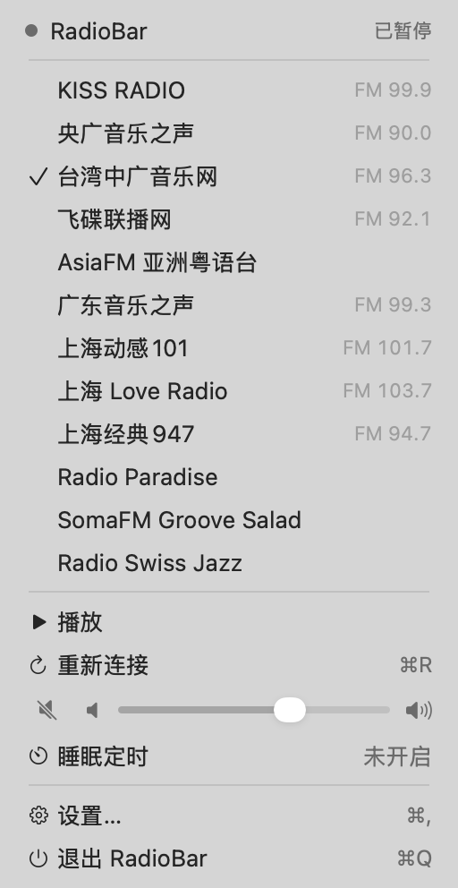
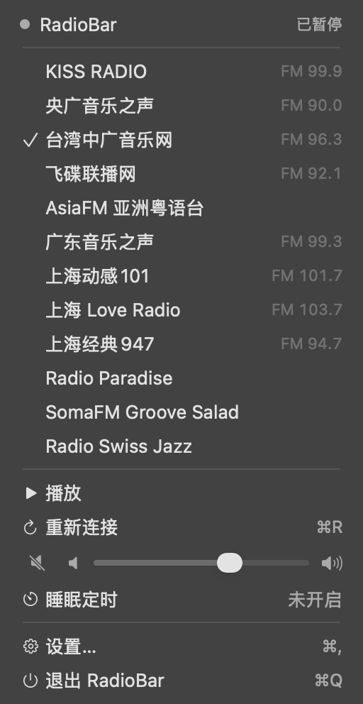
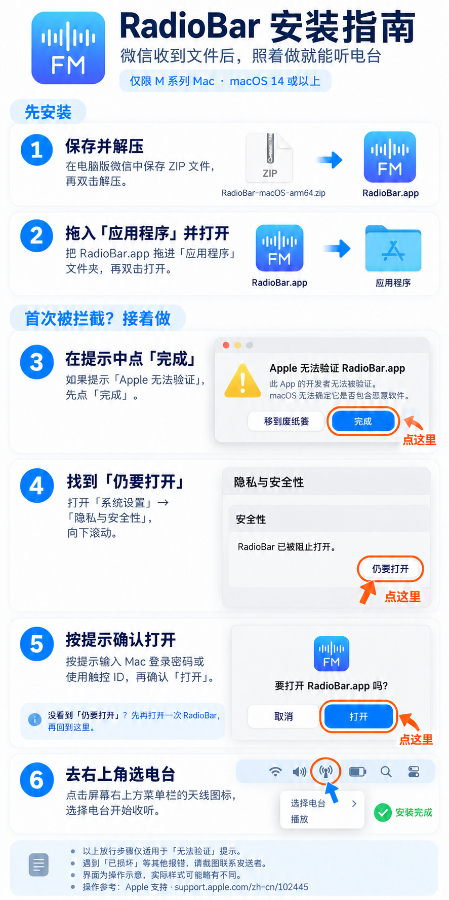
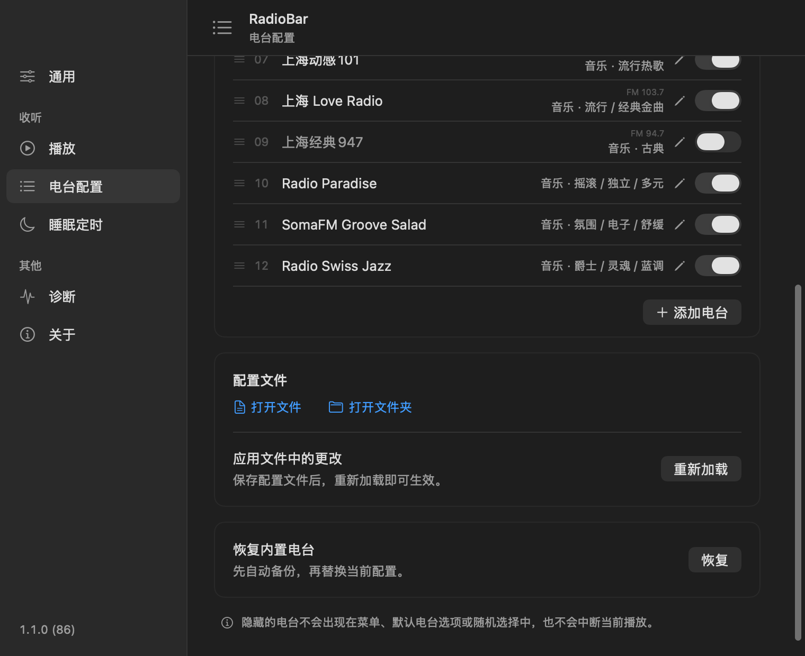

<h1 align="center">RadioBar</h1>

把电台放进 Mac 菜单栏，随手打开，安心听歌。

  
  
  

  
  &nbsp;&nbsp;
  

浅色 / 深色 · 基于当前源码生成的界面预览

当前源码从 **2.0.0** 开始维护，合并此前版本的功能与更新记录；现有用户配置和偏好继续保留。

## 想做什么

一个自用的 Mac 菜单栏电台小工具，选台与播放控制都在菜单栏完成。工作、阅读或放空时，随手打开，留一点音乐陪伴。

- **打开就听**：内置 12 个电台，可从上次收听、固定电台或随机电台开始。
- **自由管理**：添加、编辑或删除普通电台，拖动调整顺序，按需显示或隐藏。
- **定时休息**：支持 1 至 720 分钟睡眠定时。
- **融入 Mac**：外观跟随系统，支持简体中文、繁體中文与 English。

## 安装与环境

支持 **macOS 14 及以上的 Apple Silicon Mac（M 系列芯片）**，收听需要网络连接。

1. 前往 [下载页面](https://github.com/GiaoGiaoCat/RadioBar/releases/latest)，下载 `RadioBar-macOS-arm64.zip`。
2. 解压，将 `RadioBar.app` 拖入“应用程序”后打开；更新前先退出旧版。

**首次打开被拦截？请按下图操作。** 当前版本仅 ad-hoc 签名，尚未经过 Apple 公证。若提示“Apple 无法验证”，请先确认文件来源可信且未被篡改，再按照图中步骤打开。

  

点击图片查看大图，也可保存后随安装包通过微信发送。系统界面为操作示意，实际样式可能略有不同。

图中的放行步骤仅适用于“无法验证”提示；如遇“已损坏”等其他报错，请先反馈具体提示。详见 [Apple 官方说明：在 Mac 上安全地打开 App](https://support.apple.com/zh-cn/102445)。

## 用法

点击菜单栏的天线图标，选择电台即可播放；菜单内可暂停、重连、静音和调整音量。

在“设置”里管理电台、启动行为、外观和睡眠定时。

菜单展开时可用：`空格` 播放 / 暂停、`⌘R` 重连、`⌘,` 打开设置、`⌘Q` 退出。

### 电台使用规则

在“设置 → 电台配置”中管理电台：

- **添加与编辑**：普通电台可添加、编辑或删除；KISS 与央广 Music Radio 只能排序和隐藏。
- **排序与显示**：拖动左侧手柄排序，右侧开关控制显示，更改自动保存。至少保留一个显示台，隐藏不打断当前播放。
- **手动配置**：点击“打开文件”编辑 `stations.json`，保存后点击“重新加载”。
- **恢复默认**：“恢复默认顺序”只调整顺序；“恢复内置电台”会先备份再替换列表，覆盖自定义内容。

地址填写、备份与其他规则详见 [电台 JSON 配置说明](docs/STATIONS.md)。

### 配置同步（可选）

在“设置 → 配置同步”中设置 iCloud 文件夹，即可将电台资料、排序、显示选择和默认模式从 Mac 单向同步至 iPhone。修改后自动同步，也可点击“立即同步”。仅支持一台 Mac 管理，iPhone 只读，同步可能有延迟。详见 [配置说明](docs/STATIONS.md)。

  

电台配置页向下滚动后的界面 · 基于当前源码生成的预览

## 从源码编译

开发环境、构建输入及编译步骤见 [源码编译指南](docs/BUILD.md)。

[更新日志](CHANGELOG.md) · [开发交接](docs/HANDOFF.md) · [UI 设计规范](docs/UI_GUIDELINES.md) · [开发脚本与验证](docs/TESTING.md)
